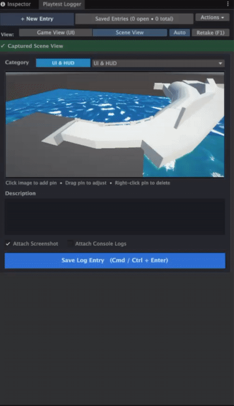
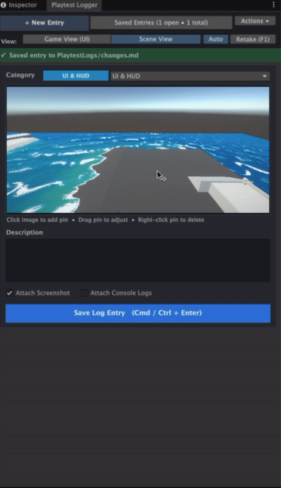
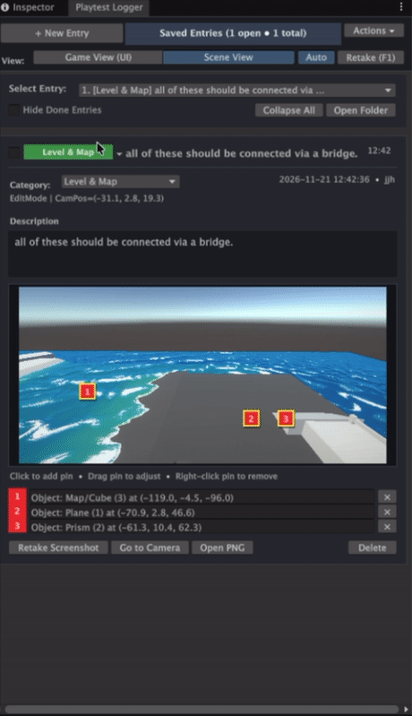

<div align="center">


<p>
  
  
  <a href="LICENSE"></a>
</p>

<p><a href="#features">Features</a> · <a href="#installation-unity-package-manager">Installation (Unity Package Manager)</a> · <a href="#usage">Usage</a> · <a href="#editing-saved-entries">Editing saved entries</a> · <a href="#done-deleted-and-tidy">Done, deleted, tidy</a> · <a href="#output">Output</a> · <a href="#license">License</a></p>

</div>

A lightweight, zero-runtime-overhead Unity Editor window for logging bugs, UI feedback, and gameplay changes while working in **Play Mode** or **Edit Mode**.

Every entry saves directly into `<ProjectRoot>/PlaytestLogs/` (`changes.md` Markdown checklist + `entries.json` + annotated/clean PNG screenshots + Unity Console snapshots), making it effortless to review yourself or feed directly to coding agents.

Hit **F1**, retake the view you are looking at, drop numbered pins on the screenshot, describe what is wrong, and save — the whole loop takes seconds and runs entirely inside the Editor.



## Features

- **Dedicated Standalone Window** (`Window -> Playtest Logger` or **`Cmd/Ctrl+Shift+L`**, quick capture on **`F1`** by default) — stays out of your Scene View and Game View.
- **Captures UI & 3D Views** — grabs either **Game View (including `Screen Space - Overlay` UI Canvases)** or **Scene View** in both Play Mode and Edit Mode.
- **Interactive Adjustable Markers** — click anywhere on a screenshot to place numbered callout pins, **drag pins** to adjust their position at any time, or right-click a pin to remove it. Automatically detects the UI `RectTransform` hierarchy path (`UI: Canvas/...`) or 3D Collider object under each pin (pick which layers the raycast hits in **Settings**).
- **Full Editing & Retake on Saved Entries** — edit categories, descriptions, marker positions/labels, or **retake the screenshot** on any previously saved entry without losing your notes or pins.
- **Markdown + Console Log Snapshots** — writes a clean `- [ ]` / `- [x]` checklist to `PlaytestLogs/changes.md` alongside recent Unity Console logs and stack traces.

## Installation (Unity Package Manager)

1. Open Unity and go to **`Window -> Package Manager`**.
2. Click **`+ -> Add package from git URL...`**.
3. Paste:
   ```text
   https://github.com/nsawill1405/unity-playtest-logger.git
   ```

## Usage

- Press **`F1`** (or your own key, set in **Settings**) at any time (Play Mode or Edit Mode) to open **Playtest Logger** and snap the view you were just looking at (Game View or Scene View), or open it via **`Window -> Playtest Logger`** (`Cmd/Ctrl+Shift+L`).
- Switch between the **+ New Entry** and **Saved Entries** tabs at the top. The **View** toggle picks Game View or Scene View and retakes the draft screenshot; switching Unity's own Scene/Game tabs leaves the draft alone.
- **Settings**: change the **Quick Capture Key** (click it and press the new key; this is also under **Edit > Shortcuts > Playtest Logger**) the **Pin Raycast Layers** used to name the object under a pin, and **Keep Window on Top** to float the logger above Unity's other windows (it can't be docked while this is on).
- **Actions** menu: **Quick Screenshot Now** (saves a separate entry without touching your draft), **Pause Play Mode on Quick Capture**, **Ask Before Deleting Entries**, **Open PlaytestLogs Folder**, **Open changes.md**.
- **Markers**: Left-click a screenshot (new or saved) to drop a numbered pin, **drag** a pin to move it, or **right-click** it to delete it. Saved PNGs are re-rendered from the clean capture with matching numbers drawn next to each pin.
- **Saved Entries**: Tick the checkbox to mark an entry done (`- [x]` in `changes.md`), edit category/description/pin labels inline, or **Retake Screenshot** to replace its image in place. **Go to Camera** moves the Scene View camera to the position and rotation the screenshot was taken from (entries captured before v1.3.0 don't have this). **Delete** removes the entry's screenshots and console log too. It asks for confirmation unless you pick **Delete, Don't Ask Again**; turn the prompt back on with **Actions > Ask Before Deleting Entries**.
- Your draft (screenshot, pins, description) survives script reloads and entering Play Mode, and window toggles are remembered between sessions.

## Editing saved entries

Saved entries are never write-once. Change the category, tweak the description, drag pins to new positions or delete them, and the entry's PNGs are re-rendered from the clean capture. **Retake Screenshot** replaces the image in place without touching your notes, and **Go to Camera** jumps the Scene View to wherever the shot was taken so you can check the issue again right away.



## Done, deleted, and tidy

Mark an entry done and it becomes a `- [x]` line in `changes.md`. **Hide Done Entries** clears finished work out of the way until you need it back. **Delete** removes the entry's screenshots and console log too, asking for confirmation first — pick **Delete, Don't Ask Again** once and it stops asking. **Collapse All** folds long sessions down to a one-line summary per category.



## Output

```text
PlaytestLogs/
  changes.md        Markdown checklist, newest first
  entries.json      Source of truth for the window
  Screenshots/      <id>.png (with pins) and <id>_clean.png
  ConsoleLogs/      <id>.log (recent Console messages + stack traces)
```

If `entries.json` can't be parsed, it is moved aside to `entries.json.<timestamp>.bak` (with a Console warning) instead of being overwritten.

## License

[MIT](LICENSE) © William North. Issues and pull requests are welcome.

---

<div align="center">

<sub>Made by <a href="https://github.com/nsawill1405">William North</a> · <a href="https://nsawill.co.uk">nsawill.co.uk</a></sub>


</div>
